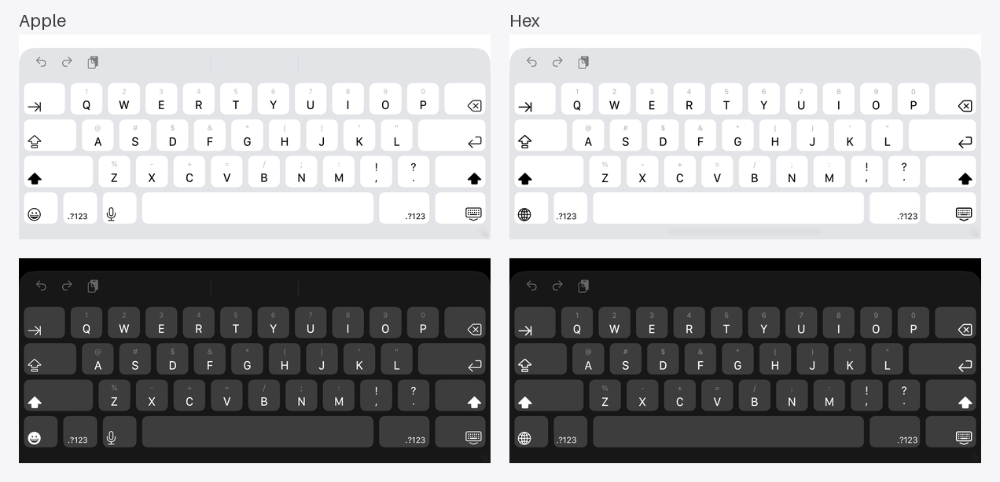

# Hex Keyboard

An open-source iOS keyboard that looks, feels and types like Apple's, built to grow into the front end for hex, a personal agent.

MIT licensed. UIKit, Swift 6, iOS 26 and later, iPhone and iPad.

Apple's keyboard on the left, Hex on the right, same simulator, iOS 26.3:




## What it does today

- Apple's iOS 26 layouts, measured against the system keyboard in the same simulator: iPhone, iPad mini, 11" and 13" iPads (with tab, caps lock, both shifts and number row), light and dark.
- Keycaps in SF Compact, the face the system keyboard uses, at the same size and position.
- Key pop-ups on iPhone, long-press accents, slide-off typing, multi-touch rollover.
- Shift, double-tap caps lock, hold shift to type capitals, auto-capitalization, double-space period.
- `123` and `#+=` layers; press `123` and slide to a symbol to type it and come back.
- Delete repeats on hold and speeds up to whole words.
- Hold the space bar to move the cursor.
- iPad flick-down for the gray secondary characters.
- Return key follows the field's `returnKeyType`; email, URL and search fields get their own bottom rows.
- Globe key only when iOS asks for one (`needsInputModeSwitchKey`).
- Landscape iPhone and wide (foldable-size) phones, which get the iPad mini layout.
- No network, no Full Access, no autocorrect yet.

## Build

Requires Xcode 27 and [XcodeGen](https://github.com/yonaskolb/XcodeGen).

```sh
xcodegen generate
open HexKeyboard.xcodeproj
```

Run the `Hex` scheme, then add the keyboard in Settings › General › Keyboard › Keyboards › Add New Keyboard… › Hex.

Tests:

```sh
cd Packages/HexKeyboard
xcodebuild test -scheme HexKeyboard-Package -destination 'platform=iOS Simulator,name=iPhone 17'
```

## Structure

| Path | What |
| --- | --- |
| `Packages/HexKeyboard/Sources/KeyboardCore` | Layouts and typing logic. No UIKit, fully unit tested. |
| `Packages/HexKeyboard/Sources/KeyboardUI` | The keyboard view controller, key views, metrics and theme. |
| `Keyboard/` | The keyboard extension. |
| `App/` | The containing app. |
| `UITests/` | End-to-end typing through the real extension. |

## License

MIT. See [LICENSE](LICENSE).
